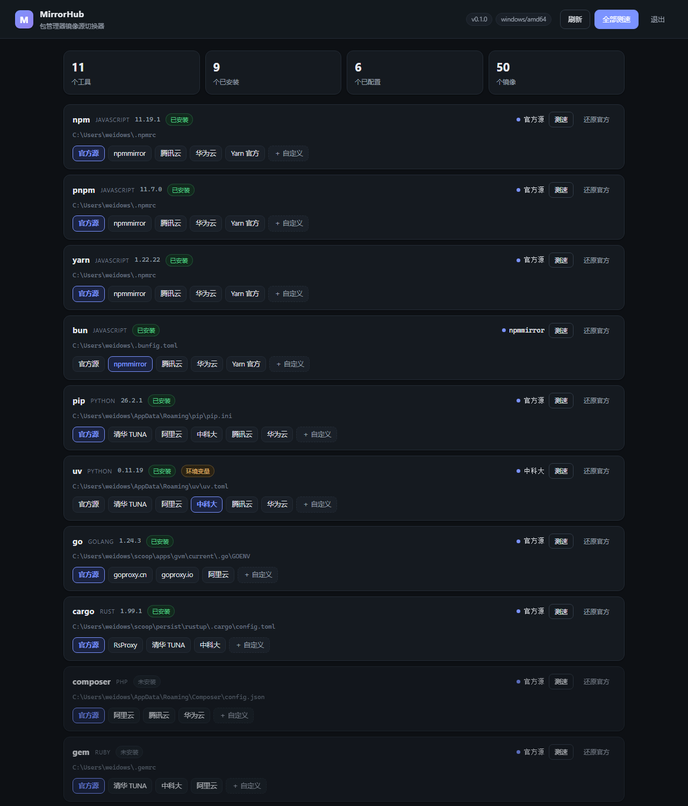

# MirrorHub

一条命令看清 **npm / pnpm / yarn / bun / pip / uv / go / cargo / composer / gem / nuget** 各自在用哪个镜像源，
测速、切换、还原都走同一套逻辑；同一个包还带一个本地图形界面，适合不想记命令的时候点两下。



## 特性

- **一眼看全**：检测 PATH 与配置文件，列出 11 个工具是否安装、版本、当前源来自文件还是环境变量。
- **维护镜像列表**：内置 50 条国内常用源，支持添加自己的私有源（写在用户配置里，升级不丢）。
- **一键测速**：并发探测，显示首字节延迟；测速遵循 `HTTP_PROXY` / `HTTPS_PROXY` / `NO_PROXY`。
- **安全写入**：只改目标键、写前备份 `<配置文件>.mirrorhub.bak`、临时文件 + rename 原子替换、`--dry-run` 预览。
- **CLI 与 GUI 同一个内核**，行为不会漂移；GUI 只监听 `127.0.0.1`，每次启动生成一次性 token。
- **对 agent 友好**：`--json` 输出统一信封，稳定的错误码与退出码，无交互、无颜色也能跑。

## 安装

```bash
# 全局安装（需要 Node.js >= 20.19）
npm install -g @mirrorhub/cli

# 或者不安装，直接跑
npx @mirrorhub/cli ls

# 从源码
git clone https://github.com/Weidows/mirrorhub.git
cd mirrorhub && npm install && npm run build
node dist/index.js ls
```

安装后有两个等价的命令名：`mirrorhub` 和 `mh`。

不想装 Node 也可以直接下载 [Releases](https://github.com/Weidows/mirrorhub/releases) 里的单文件可执行程序，
解压即用、无运行时依赖：

| 平台 | 文件 |
| --- | --- |
| Windows x64 | `mirrorhub-win32-x64.exe` |
| Linux x64 / arm64 | `mirrorhub-linux-x64` / `mirrorhub-linux-arm64` |
| macOS Intel / Apple Silicon | `mirrorhub-darwin-x64` / `mirrorhub-darwin-arm64` |

这些文件用 Node SEA（Single Executable Application）打包，体积约 90 MB（内嵌 Node 运行时与界面资源）。
双击（不带参数）会直接打开图形界面，关掉那个控制台窗口即退出；在终端里带参数运行就是普通 CLI。

## 快速开始

```bash
mh ls                       # 11 个工具现在用什么源
mh test npm                 # 测一遍 npm 家族的镜像
mh use npm npmmirror        # 切到 npmmirror
mh fastest pip --apply      # 测速后直接切到最快的 pip 源
mh reset pip                # 回到官方源
mh gui                      # 打开图形界面
```

`ls` 的输出大致是这样：

```
工具    版本       镜像       来源        地址
npm     11.19.1    npmmirror  文件        https://registry.npmmirror.com
pnpm    11.7.0     官方源     文件        https://registry.npmjs.org
pip     26.2.1     官方源     默认        https://pypi.org/simple
uv      0.11.19    中科大     环境变量    https://mirrors.ustc.edu.cn/pypi/simple
...
11 个工具 · 9 个已安装 · 2 个已切换到非官方源
提示：环境变量仍优先于配置文件：uv
```

## 命令

| 命令 | 说明 |
| --- | --- |
| `ls [--installed]` | 列出工具、版本、当前镜像与来源；`--installed` 只看已安装 |
| `mirrors [工具]` | 列出内置与自定义镜像（含 id 与 URL） |
| `test [工具] [--refresh]` | 并发测试可用性与延迟；结果缓存 5 分钟 |
| `use <工具> <镜像>` | 切换镜像，镜像可写 id、名称或完整 URL |
| `reset <工具>` | 还原官方源，只删自己写的键 |
| `fastest <工具> [--apply]` | 选延迟最低的可用镜像，`--apply` 直接切换 |
| `add <工具> --name <名称> --url <地址> [--note <备注>]` | 添加自定义镜像 |
| `rm <工具> <镜像 id>` | 删除自定义镜像（内置镜像不可删） |
| `gui [--port N] [--no-open]` | 启动本地图形界面 |
| `version` / `help [命令]` | 版本与帮助 |

全局选项：`-j, --json`、`-n, --dry-run`、`--no-color`、`-v, --verbose`、`-h, --help`。

## 给脚本和 agent 用

所有命令加 `-j` 都会输出同一个信封，成功与失败都只有一层结构：

```bash
$ mh ls -j
{"ok":true,"data":{"summary":{"tools":11,"installed":9,"configured":2},"tools":[...]}}

$ mh use npm no-such-mirror -j
{"ok":false,"error":{"code":"unknown_mirror","message":"npm 没有镜像 no-such-mirror","hint":"用 mirrorhub mirrors npm 查看可用镜像"}}
```

- 退出码：`0` 成功，`1` 运行失败（读写、网络），`2` 用法错误（未知命令/工具/镜像）。
- 错误码：`unknown_tool`、`unknown_mirror`、`bad_request`、`read_failed`、`write_failed`、`not_found`、`no_usable_mirror`。
- 修改类命令先加 `--dry-run` 可以拿到完整计划而不写盘；`data.dry_run` 会是 `true`。
- 管道提前关闭（例如 `| head`）时安静退出，不打印堆栈。

## 支持的工具与配置文件

| 工具 | 类别 | 配置文件 | 环境变量（优先） |
| --- | --- | --- | --- |
| npm | JavaScript | `~/.npmrc` | `NPM_CONFIG_REGISTRY` |
| pnpm | JavaScript | `~/.npmrc`（与 npm 共用） | `NPM_CONFIG_REGISTRY` |
| yarn | JavaScript | `~/.yarnrc.yml`（berry）或 `~/.yarnrc`（classic） | — |
| bun | JavaScript | `~/.bunfig.toml` | `BUN_CONFIG_REGISTRY` |
| pip | Python | `%APPDATA%/pip/pip.ini` 或 `~/.config/pip/pip.conf` | `PIP_INDEX_URL` |
| uv | Python | `%APPDATA%/uv/uv.toml` 或 `~/.config/uv/uv.toml` | `UV_INDEX_URL` / `UV_DEFAULT_INDEX` |
| go | Go | `go env GOENV` 指向的文件 | `GOPROXY` |
| cargo | Rust | `~/.cargo/config.toml` | `CARGO_HOME` |
| composer | PHP | `%APPDATA%/Composer/config.json` 或 `~/.config/composer/config.json` | `COMPOSER_HOME` |
| gem | Ruby | `~/.gemrc` | — |
| nuget | .NET | `%APPDATA%/NuGet/NuGet.Config` | — |

内置镜像：npm 家族 5 条、pip/uv 各 6 条、go/cargo/composer/gem 各 4 条、nuget 2 条。
环境变量的优先级高于配置文件：如果检测到 `origin: "env"`，`use` 仍会改文件，但需要你自己处理环境变量，
`ls` 会在页脚提醒「环境变量仍优先于配置文件」。

## 图形界面

`mh gui` 会在 `127.0.0.1` 上起一个临时端口并打开浏览器：

- 只监听本机回环地址，不对外暴露；
- 每次启动生成随机 token，所有写操作需要 `X-MH-Token`，且只接受 POST；
- 同一时间只保留一个实例，重复执行 `mh gui` 会复用已打开的窗口；
- 页面右上角的「退出」会关闭服务；也可以 Ctrl+C。

`--no-open` 只起服务不打开浏览器，`--port N` 固定端口。

## 安全与回滚

- 写入前把原文件复制为 `<配置文件>.mirrorhub.bak`（只有一个备份，覆盖式）。
- 用同目录临时文件 + `rename` 原子替换，避免写一半掉电留下坏文件。
- 只增删自己管理的键：npm 的 `registry`、pip 的 `index-url`/`trusted-host`、cargo 的 `[source.mirrorhub]`、
  nuget 的 `key="mirrorhub"` 等；token、私有源、其它配置原样保留。
- `reset` 不会恢复「你上次手动改的值」，它只负责把自己写进去的东西删掉，让工具回到官方默认。

## 开发

```bash
npm install
npm run build     # tsc -> dist/
npm test          # 构建后跑 37 个测试（doc / adapters / service / CLI）
npm run dev -- ls # 用 Node 的类型擦除直接跑 src/index.ts
npm run build:sea # 当前平台的单文件可执行程序 -> build/mirrorhub-<platform>-<arch>
```

构建会先用 `scripts/gen-assets.mjs` 把 `assets/` 里的 html/css/js 生成为 `src/gui/assets.gen.ts`，
这样 CLI、npm 包和单文件二进制都不依赖外部资源目录。

目录：

```
src/
  catalog.ts        内置镜像数据
  registry.ts       11 个工具的元信息（二进制名、版本参数）
  manager/          配置读写：ctx（文件/进程）、doc（行编辑器）、adapters（每工具一个）
  probe.ts          HTTP(S) 探针（支持 HTTP 代理 CONNECT）
  app.ts            Service：CLI 与 GUI 共用的唯一入口
  userconfig.ts     自定义镜像持久化
  cli/              参数解析、帮助、表格输出、退出码
  gui/server.ts     本地 HTTP 服务（界面由 assets.gen.ts 内嵌）
assets/             GUI 的 html/css/js 源文件
scripts/           界面内嵌 + Node SEA 打包
test/               node:test，跑构建后的 dist
```

## 发布

版本号写在 `package.json`（`src/version.ts` 与之一致，测试会校验）。发版流程：

```bash
npm version patch         # 或 minor / major，同时打 tag
git push --follow-tags
gh release create v0.1.1 --title v0.1.1 --notes "..."   # 发布 release 即触发工作流
```

`.github/workflows/release.yml` 在 release 发布后做两件事：

1. 在五个原生 runner 上构建单文件二进制（Node SEA 的 V8 blob 与平台绑定，不能交叉编译），
   作为 release 附件上传；
2. 校验 tag 与 `package.json` 版本一致后执行 `npm publish --access public --provenance`。

npm 发布需要在仓库 Secrets 里配置 `NPM_TOKEN`（npmjs.com → Access Tokens → Granular Access Token，
勾选读写 `@mirrorhub` scope 与 `mirrorhub` 组织）；没有这个 secret 时工作流会跳过发布并给出警告。
`ci.yml` 在 push / PR 时跑一遍 `npm test`。

## License

[MIT](./LICENSE)
